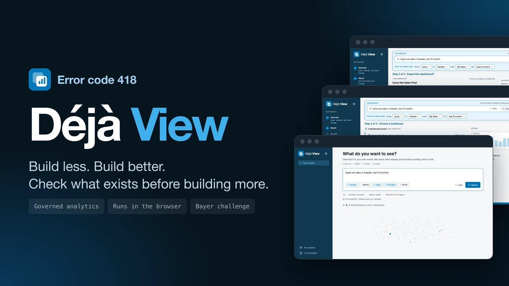

<p align="center">
  
</p>

<h1 align="center">Error code 418</h1>

<p align="center">
  The portfolio of four interaction designers from Umeå University, and the things we build together.<br>
  <a href="https://jacobberggreen.github.io/error-code-418-portfolio/"><b>jacobberggreen.github.io/error-code-418-portfolio</b></a>
</p>

<p align="center">
  <a href="https://github.com/Jacobberggreen/error-code-418-portfolio/actions/workflows/ci.yml"></a>
  <a href="https://github.com/Jacobberggreen/error-code-418-portfolio/actions/workflows/pages.yml"></a>
  
  
  
</p>

## What this is

A single-page site for **Error code 418**: Jacob Berggren, Omar Lundgren, Sebastian Gabrielsson and Adam Hultgren. It shows what we have built together and who we are.

- **Work**: an index of projects. Each opens a full-screen case with the walkthrough, the story and the numbers.
- **Team**: one tile per person, with a profile, the projects they worked on, GitHub and LinkedIn.
- **Command palette**: press <kbd>⌘</kbd>/<kbd>Ctrl</kbd> + <kbd>K</kbd> to jump to a project, a person or a link.

The name is the HTTP status [418, "I'm a teapot"](https://datatracker.ietf.org/doc/html/rfc2324). The footer answers it.

## Stack

React 19 · Vite 7 · plain CSS (no framework) · GSAP for the intro · Phosphor icons. Deployed to GitHub Pages by GitHub Actions.

## Run it locally

```bash
npm ci
npm run dev        # http://localhost:5173
```

| Command           | What it does                              |
| ----------------- | ----------------------------------------- |
| `npm run dev`     | Dev server with hot reload                |
| `npm run build`   | Production build into `dist/`             |
| `npm run preview` | Serve the production build locally        |
| `npm run lint`    | ESLint                                    |

Requires Node 20 or newer.

## Add a project

All content is data. Nothing in the components needs to change.

1. Put the images in `public/images/`.
2. Copy the object in [`src/data/projects.js`](src/data/projects.js), change the fields and set `cover` and `gallery`.
3. Push to `main`. The site redeploys itself.

Team members live in [`src/data/team.js`](src/data/team.js): name, GitHub, LinkedIn and an optional photo in `public/team/`.

## Project structure

```
src/
  components/   Hero, Work, Team, CaseStudy, MemberDialog, CommandPalette, Modal ...
  data/         projects.js, team.js, site.js: all content
  styles.css    tokens first, then one section per part of the page
public/
  images/       project images and film
  team/         portraits
.github/
  workflows/    ci.yml (lint + build), pages.yml (deploy)
```

## Design notes

Near-black ground, one coral accent, Bricolage Grotesque for headings and Inter for text. Controls are square, and slanted bands are used for the team. Motion is transform and opacity only, and everything respects `prefers-reduced-motion`.

## Deployment

Every push to `main` runs [`pages.yml`](.github/workflows/pages.yml): install, build, publish `dist/` to GitHub Pages. The Vite `base` is relative (`./`), so the same build works under `/<repo>/` and on a custom domain.

## License

Copyright © 2026 Team Error code 418. All rights reserved. See [LICENSE](LICENSE). You may read the code, but not copy, reuse or redistribute it, or the images, without written permission.
